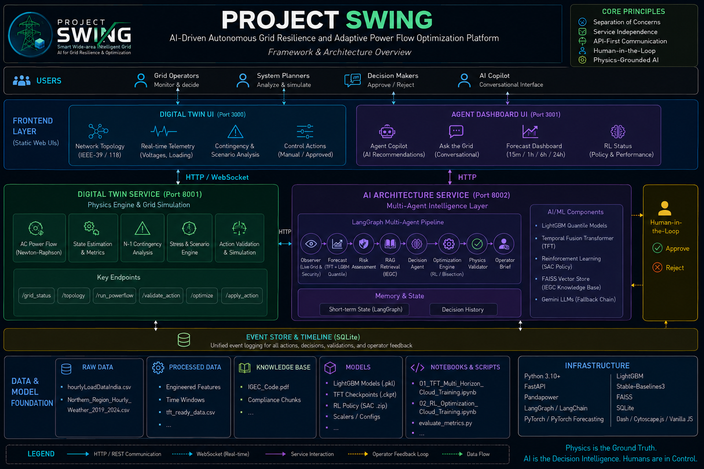

# Project SWING

**AI-Driven Autonomous Grid Resilience and Adaptive Power Flow Optimization Platform**



Project SWING is an AI-powered operating platform for electrical grid resilience. It combines a high-fidelity power-system Digital Twin, statistical and deep-learning forecasting, a multi-agent LangGraph decision pipeline, a reinforcement-learning-assisted optimization engine, and a Retrieval-Augmented Generation (RAG) compliance layer - all with a human operator kept firmly in the loop.

The Digital Twin is infrastructure, not the project itself. It provides the physical ground truth every AI component reasons against. Nothing bypasses it, and every proposed control action is re-validated against real AC power flow before it is ever shown to an operator.

---

## Capabilities

- Interactive IEEE 39/118 topology, status, and telemetry views.
- Scenario simulation, contingency analysis, and optimization endpoints.
- Load forecasting with LightGBM quantile models and an optional TFT model.
- AI-assisted recommendations with validation and approval workflow.
- Optional regulatory retrieval and Gemini integration when configured.
- Local development APIs, security checks, browser tests, and an optional single-host Docker Compose deployment.

Online AI and model inference depend on the installed packages and verified artifacts. If a model or provider is unavailable, the application should fail safely or use its documented fallback; never treat an unavailable result as an approved action.

## Architecture

```text
Browser ── Twin UI ──┐                    ┌─ Digital Twin API ── IEEE simulations
                     ├─ same-origin proxy ┤                     └─ SQLite event log
Browser ── Agent UI ─┘                    └─ Agent API ────────┘
                                                            └─ optional Gemini
```

The Twin and Agent are separate Python services. In Compose, only the Nginx TLS proxy publishes a loopback-bound host port; the Agent reaches the Twin over a private Docker network. Both services mount the same persistent SQLite volume. This is a single-host design, not a multi-host database architecture.

## Requirements

- Python 3.12 (64-bit); a compatible native OpenMP runtime for LightGBM.
- Node.js 22 and npm for browser tests.
- Docker Engine with the Compose plugin only for container deployment.
- Optional Google API key for online Gemini features.

The supplied SAC archives record Python 3.10 training metadata. Their inference compatibility on Python 3.12 must be verified before relying on them. See [artifact policy](docs/ARTIFACT_POLICY.md) and [preservation matrix](docs/PRESERVATION_MATRIX.md).

## Local development

Create an isolated Python environment, install dependencies, and run each service in its own terminal:

```bash
python3.12 -m venv .venv
source .venv/bin/activate
python -m pip install -r requirements.txt
python scripts/run_twin.py
```

In another terminal, activate the same environment and run:

```bash
python scripts/run_agent.py
```

The default API addresses are `http://127.0.0.1:8001` (Twin) and `http://127.0.0.1:8002` (Agent). Serve `Digital_Twin_UI/` and `Agent_Dashboard_UI/` from local static web servers to use the dashboards. API docs are at `/docs` on each service. Local auth permits loopback requests only.

Copy `.env.example` to an untracked `.env` only when overrides are needed. Do not put secrets in browser code, notebooks, Git, or build arguments. See [configuration](docs/CONFIGURATION.md).

## Checks

```bash
python -m compileall -q main.py modules scripts tests
python scripts/security_audit.py --tracked --self-test
pytest -q
npm ci
npx playwright test
```

Read-only local service smoke check (start all four local services first):

```bash
python scripts/smoke_test.py --local --no-mutation
```

The smoke script targets loopback APIs and static pages on ports 3000/3001. It does not run a production deployment. Deployment bundle preflight is static only:

```bash
python scripts/validate_deployment.py
```

## Container deployment

The Compose deployment is an optional single-host TLS blueprint. It needs Docker, a protected host `.env`, and valid certificate files in the ignored `deploy/certs/` directory. See [secret setup](deploy/SECRETS.md) and [backup/rollback](deploy/ROLLBACK.md).

Remote APIs currently use static bearer tokens, and the browser dashboards do not provide a login or token-entry flow. Therefore, general-user, write-enabled browser deployment is **not ready**. The deployment workflow is manual and protected by the GitHub `production` environment; configure its reviewers, host key, SSH secrets, host `.env`, and TLS assets before use. Never run it against a host without explicit deployment authorization.

The example Nginx server name is `swing.example.com`; replace it with the real DNS name and ensure the certificate and `SWING_ALLOWED_ORIGINS` agree. The workflow's host-local TLS smoke command currently expects port 8443 and the example hostname. Update that command if deployment settings differ. Do not claim deployment success from a static preflight.

## Configuration and security

Important settings include `SWING_OPERATION_MODE`, `SWING_TWIN_BIND_HOST`, `SWING_AGENT_BIND_HOST`, `DIGITAL_TWIN_API_URL`, `SWING_EVENT_DB_PATH`, `SWING_DATA_DIR`, `SWING_MODEL_DIR`, `SWING_FAISS_DIR`, `SWING_ALLOWED_ORIGINS`, `SWING_AUTH_MODE`, the three service tokens, and optional `GOOGLE_API_KEY` / `SWING_GEMINI_MODEL_*` values. `.env.example` lists the available settings; [configuration](docs/CONFIGURATION.md) describes their current behavior.

`SWING_OPERATION_MODE=simulation` is the only supported mode. The current remote auth implementation validates static bearer tokens; OIDC-related variables are reserved and do not activate OIDC. Keep Twin administrative credentials out of the Agent and browser. See the [threat model](docs/THREAT_MODEL.md), [API contract](docs/API_CONTRACT.md), [attributions](docs/ATTRIBUTIONS.md), and [regulatory source notes](docs/REGULATORY_SOURCES.md).

## License and third-party material

See [LICENSE](LICENSE) for the repository license. The project owner authorized public redistribution of the supplied archive. The source PDF, datasets, model artifacts, and third-party libraries may retain separate terms; the repository license does not override them. See [artifact policy](docs/ARTIFACT_POLICY.md) and [attributions](docs/ATTRIBUTIONS.md).
